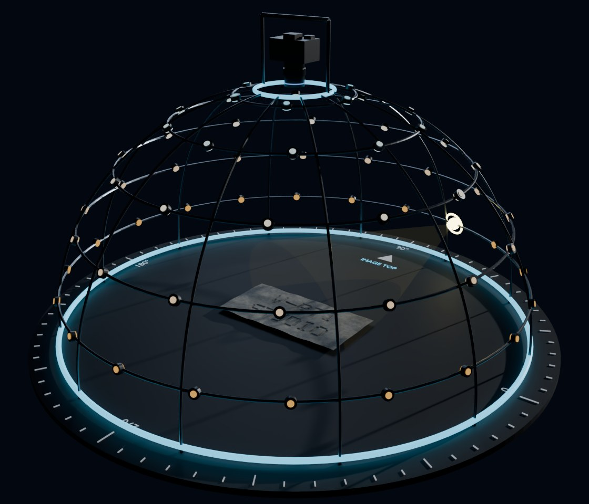
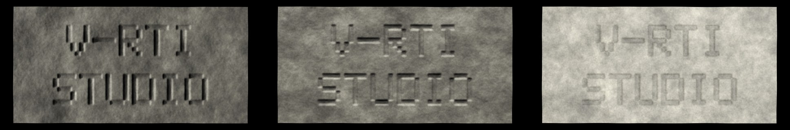
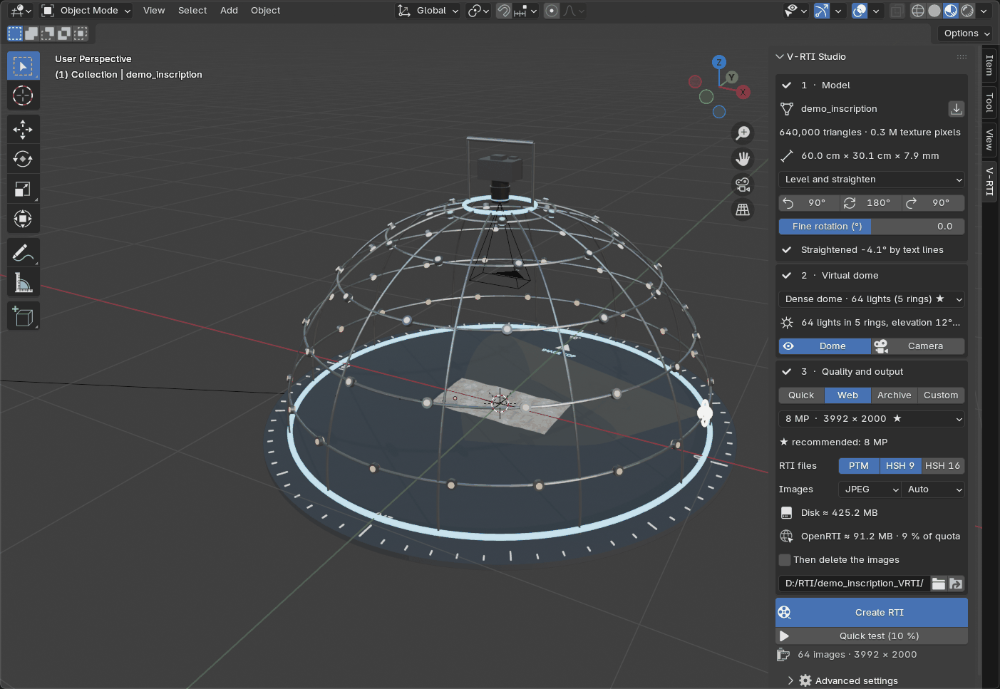

# V-RTI Studio

[](https://github.com/Ayqi/V-RTI-Studio/actions/workflows/ci.yml)
[](LICENSE)


**Virtual Reflectance Transformation Imaging for Blender.** V-RTI Studio turns a
photogrammetric model (OBJ + MTL, for example an Agisoft Metashape export) into a
complete RTI data set: a multi-light image sequence, a Light Position (`.lp`) file,
and fitted **PTM** (`.ptm`) and **HSH** (`.rti`) files that open in RTIViewer, relight
and web viewers such as [OpenRTI](https://openrti.org).

<p align="center"></p>

The add-on works as a real dome does: LEDs in rings on a hemisphere, a camera at the
zenith, one image per light. The light directions are known analytically, so the `.lp`
file carries none of the error of highlight detection.

<p align="center"></p>

## Features

- **Three steps and one button.** Import a model, pick a dome, pick a quality tier, press *Create RTI*.
- **Automatic pose.** The inscribed face is levelled and turned square to the camera, with text lines as the main cue. The camera frames the specimen by itself.
- **Domes from 36 to 120 lights**, or your own rings, with collimated light (the PTM/HSH assumption) or physical LEDs.
- **Size recommendation.** A ladder of real camera sizes, with ★ on the smallest one that keeps the visible detail of the model.
- **Small by default.** JPEG captures and a Web tier meant for upload, with disk and OpenRTI size estimates in the panel. 16-bit TIFF masters are one click away.
- **Exposure by measurement.** The brightest light peaks at 0.95 on specimen pixels, without clipping.
- **Standard folder layout.** The output follows RTIBuilder, so you can process the images yourself in RTIBuilder, relight or RelightLab.
- **Provenance.** A capture record (camera, lights, pose, software) and a fit report with the residual on specimen pixels.

## Installation

Requires Blender 4.2 or newer. NumPy and OpenImageIO ship with Blender, so there is nothing else to install.

1. Download `vrti_studio-<version>.zip` from [Releases](https://github.com/Ayqi/V-RTI-Studio/releases). Do not unpack it.
2. In Blender, open *Edit ▸ Preferences ▸ Get Extensions ▸ ⌄ ▸ Install from Disk…* and pick the file.
3. The panel is in the 3D Viewport sidebar (**N** key), under the **V-RTI** tab.

## Quick start



1. **Model:** *Import OBJ / MTL*. Importing replaces the objects in the scene (*Clear scene* in the file dialog turns this off; **Ctrl+Z** undoes it).
2. **Virtual dome:** keep the ★ layout, or pick another one.
3. **Quality and output:** keep *Web* and choose a folder.
4. **Create RTI.** *Quick test* does the same at 10 % size.

No model at hand? With a clone of this repository, generate a small test slab:

```bash
blender -b --factory-startup --python scripts/make_demo_specimen.py -- demo_specimen
```

The [user guide](docs/USER_GUIDE.md) covers the tiers, the output folder and the other RTI tools.

<br clear="right">

## Output

| Tier | Size | RTI files | Images | For |
|---|---|---|---|---|
| Quick | ≤ 8 MP | PTM | JPEG | framing and material checks |
| Web (default) | ≤ 16 MP | PTM-LRGB + HSH 9 | JPEG | OpenRTI, web viewers, everyday use |
| Archive | ≤ 36 MP | PTM + HSH 9 + HSH 16 | 16-bit TIFF + JPEG set | archives, full-frame H-RTI level |

```text
<name>_VRTI/
  README.txt
  <name>_capture.json     camera, dome, lights, pose at capture time, software
  original-captures/      TIFF renders + <name>.lp (only with TIFF captures)
  jpeg-exports/           JPEG images + <name>.lp
  assembly-files/         <name>.lp with absolute paths (RTIBuilder style)
  finished-files/         .ptm, .rti, fit report, OpenRTI record suggestions
```

## Limitations

The colour texture of a photogrammetric model already contains the lighting of the
original photographs, and the material (roughness, specular) is an assumption rather
than a measurement. The result is a virtual RTI of the digital model. It is not a
measurement of the reflectance of the physical object. See
[Scientific notes](docs/SCIENCE.md) for the conventions and mathematics.

## Contributing

Bug reports and pull requests are welcome. See [CONTRIBUTING.md](CONTRIBUTING.md) for
how to run the tests. Changes are listed in the [changelog](CHANGELOG.md).

## Citation

If you use V-RTI Studio in research, please cite it. The metadata is in
[CITATION.cff](CITATION.cff), and GitHub offers it as *Cite this repository*.

## License

Copyright © 2026 A. Akçay. Released under the
[GNU General Public License v3.0 or later](LICENSE).
